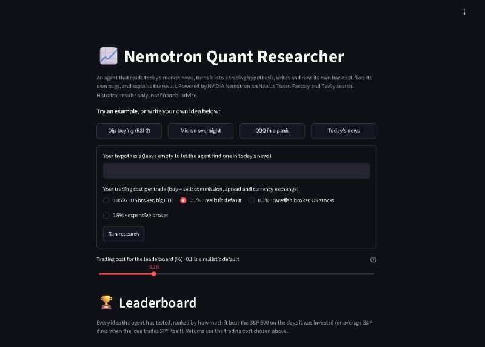
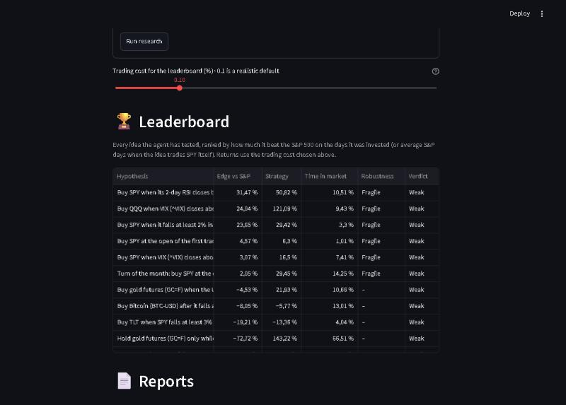
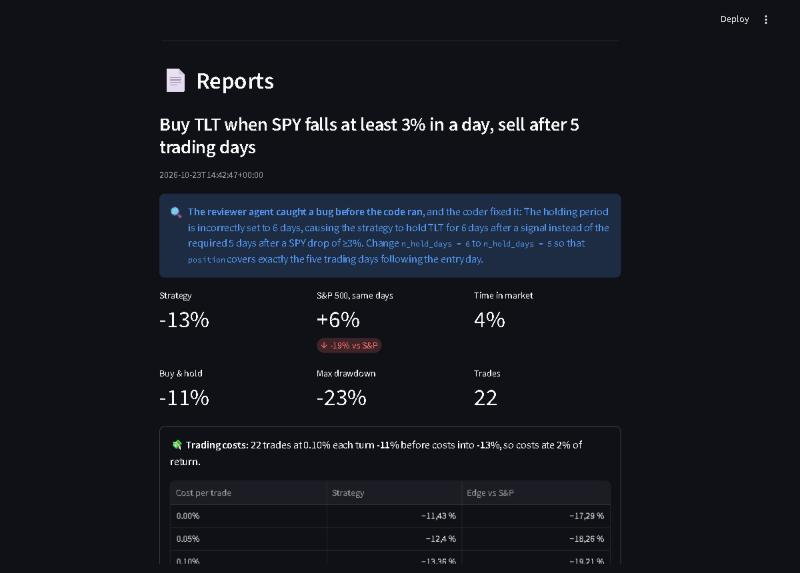
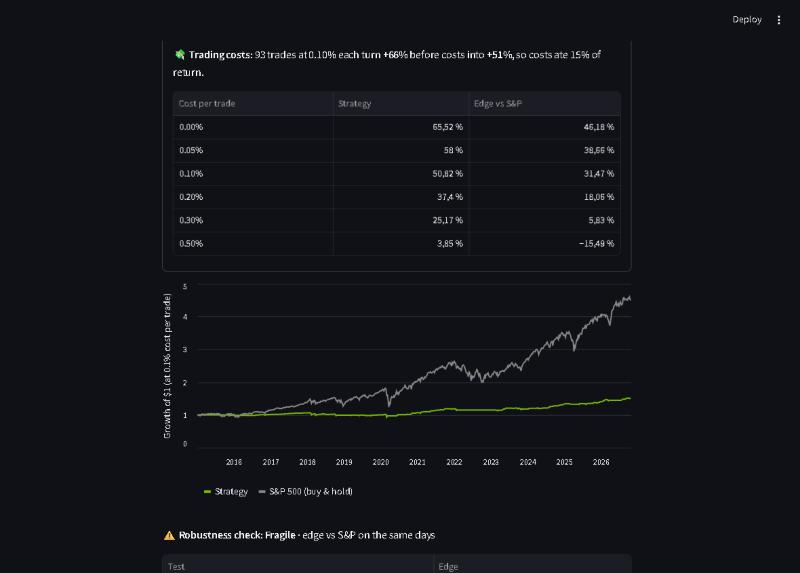

# Nemotron Quant Researcher

An AI agent that does the boring part of quant research on its own: it reads today's market news, turns it into a testable trading hypothesis, writes the backtest code, runs it, fixes its own bugs, and explains in plain English whether the idea would have worked since 2015.

Built for the [Nebius x NVIDIA Global AI Hackathon](https://nebiusglobalaihackathon.devpost.com/) (Coding and Agentic Engineering track).

**Live demo:** https://nemotron-quant-researcher.streamlit.app · **Video:** _add YouTube link here_



| Every idea ranked by its edge over the S&P 500 | The reviewer agent catching a bug before the code ran |
|---|---|
|  |  |



## Why

Most trading ideas sound good in a headline and fail in a backtest. Testing one by hand takes an evening of pandas. This agent tests one in about two minutes, and it is honest about the result: most ideas come back "Weak", which is the point.

## How it works

```
Tavily news search ──► Nemotron Super ──► hypothesis
                                              │
             ┌────────────────────────────────┘
             ▼
     Nemotron Ultra writes backtest.py ◄──────────────┐
             │                                         │ error / impossible numbers
             ▼                                         │ (up to 3 attempts)
     run in a subprocess (no API keys, 120 s timeout) ─┘
             │ RESULT json
             ▼
     sanity checks ──► Nemotron Super explains ──► report + UI
```

1. **Find an idea** (`find_hypothesis`): Tavily searches today's market news, Nemotron 3 Super turns the headlines into one concrete rule with Yahoo Finance tickers. It sees every idea it already tested and how it went (`past_ideas`), so it does not repeat itself and can build on what held up.
2. **Write the code** (`research`): Nemotron 3 Ultra writes a complete backtest with a fixed execution convention (signal at day T close, enter at T close, close-to-close returns), so the same idea always gives the same answer.
3. **Second opinion**: before the code runs, a reviewer agent (Nemotron 3 Super) reads it for bugs that would still run but give wrong numbers, like look-ahead bias or a position that ends too early. A bug it finds goes straight back to the coder, and the report shows what was caught.
4. **Run and self-correct**: the script runs in a separate process that never sees the API keys. If it crashes, prints nothing, or reports numbers that cannot be true (a loss over 100%, a positive drawdown, time in market above 100%), the error goes back into the conversation and Ultra fixes its own code.
5. **Explain**: Nemotron 3 Super writes a short, modest verdict. The key comparison is the **S&P 500 over the same days the strategy was active**, because a trader only runs a strategy while it is on and uses the money elsewhere the rest of the time. When the idea trades SPY itself that comparison is always zero, so it is compared with the same number of average S&P days instead. Every result includes 0.1% trading costs per trade.
6. **Check for luck**: when an idea beats the S&P 500, Ultra writes a second script that re-tests it on 2015–2020 and 2021–today separately, with trading costs doubled to 0.2%, and with every number in the rule moved about 20% up and down. It only counts as **Robust** if the edge survives both halves, the costs and at least two thirds of the variants; otherwise it is **Fragile**, and a fragile result is never called promising.
7. **Refuse to fake it**: if an idea needs data that free price history cannot give (historical EV/EBIT, insider trades), the agent says so instead of inventing a proxy.

Ideas with fewer than 20 trades are flagged as too few to trust. You pick your own trading cost when you submit an idea, and every report shows how much costs ate and what the idea returns from 0% to 0.5% per trade, because many ideas only work at zero cost. A slider does the same for the leaderboard. Every report gets an equity curve against the S&P 500, and a leaderboard ranks every idea the agent has ever tested by its edge on the days it was invested. A GitHub Actions workflow runs the whole loop every weekday morning and commits the report, so the research log grows without anyone pressing a button.

## NVIDIA and Nebius

| What | Model on Nebius Token Factory | Why |
|---|---|---|
| Writing and fixing backtest code | `nvidia/Nemotron-3-Ultra-550b-a55b` | Code has to be right; worth the bigger reasoning model |
| Turning news into a hypothesis, explaining results | `nvidia/nemotron-3-super-120b-a12b` | Fast and cheap for short text |

Token Factory's OpenAI-compatible API meant the standard `openai` client worked by changing only `base_url`, so the first Nemotron call took ten lines. A full research cycle costs about 1-3 cents of credits.

## Run it yourself

```bash
pip install -r requirements.txt
```

Create a `.env` file:

```
NEBIUS_API_KEY=your-token-factory-key
TAVILY_API_KEY=your-tavily-key
```

Then:

```bash
python agent.py                                   # let the agent find an idea in today's news
python agent.py "Buy QQQ when VIX closes above 30, sell after 10 days"
python -m streamlit run app.py                    # the web UI
python test_agent.py                              # tests for parsing, sandboxing and sanity checks
```

## Limitations (honest list)

- Data is free daily prices from Yahoo Finance since 2015: no fundamentals, no delisted tickers (survivorship bias). Costs are a flat 0.1% per trade, no slippage model.
- Generated code runs in a plain subprocess with a timeout, not a real sandbox. Fine for a demo; production would move it to Nebius Serverless Jobs.
- These are historical backtests, not financial advice.

## License

MIT
